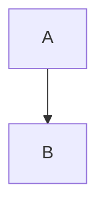

+++
title = "Shortcode Reference"
date = "2026-06-22"
description = "Reference for the note, character, image, and video shortcodes available in arata posts."
tags = ["docs", "shortcodes"]
+++

# Shortcode Reference

Arata supports the `note`, `character`, and `image` shortcodes mirroring selected apollo `templates/shortcodes/` behavior, plus the generic `video` shortcode for declarative video embeds. The first three are Gleam functions in `src/shortcodes/` that return HTML strings; `video` is written directly in Markdown as `{{ video(...) }}` and expanded at build time.

Mermaid diagrams are no longer implemented as a shortcode. Use native Markdown fenced code blocks instead:



## note

A note box with a header and content. Can be static (always visible) or dynamic (toggle button).

```gleam
import shortcodes/note

// Static note
note.view("Tip", "<p>This is always visible.</p>", False, False, False)

// Dynamic note (clickable, hidden by default, centered)
note.view("Click to expand", "<p>Hidden content.</p>", True, True, True)
```

**Parameters:**

| Param       | Type   | Description                                                   |
| ----------- | ------ | ------------------------------------------------------------- |
| `header`    | String | The header text.                                              |
| `body`      | String | The body HTML.                                                |
| `clickable` | Bool   | When `True`, the header becomes a toggle button.              |
| `hidden`    | Bool   | When `True` and clickable, the body starts hidden.            |
| `center`    | Bool   | When `True`, the header is centered instead of using an icon. |

## character

An avatar with a speech bubble.

```gleam
import shortcodes/character

character.view("hooded", "<p>The hooded figure speaks.</p>", "right", "")
```

**Parameters:**

| Param      | Type   | Description                                                                  |
| ---------- | ------ | ---------------------------------------------------------------------------- |
| `name`     | String | Character name, used for CSS classes and the default image.                  |
| `body`     | String | The speech text HTML.                                                        |
| `position` | String | `"left"` or `"right"`, which flips the row direction.                        |
| `image`    | String | Optional image filename. Defaults to `hooded.png` when `name` is `"hooded"`. |

## image

An image with lazy loading and an aspect-ratio attribute.

```gleam
import shortcodes/image

image.view("/images/photo.png", "Alt text", 800, 600, "lazy", "async")
```

**Parameters:**

| Param      | Type   | Description                            |
| ---------- | ------ | -------------------------------------- |
| `path`     | String | The image src URL.                     |
| `alt`      | String | The alt text.                          |
| `width`    | Int    | Used for the `aspect-ratio` attribute. |
| `height`   | Int    | Used for the `aspect-ratio` attribute. |
| `loading`  | String | `"lazy"` or `"eager"`.                 |
| `decoding` | String | `"async"` or `"sync"`.                 |

Image resizing, such as AVIF/WebP derivatives, is deferred to the build pipeline.
## video

A declarative, reusable video embed. Only `src` is required; everything else is optional.

The contract is renderer-neutral: authors describe video content and basic playback intent only. The current default player is an internal detail and is not a required content dependency — authored Markdown never mentions a player library, never needs a CDN `<script>` tag, and must not contain renderer-specific options, callbacks, or plugin configuration. The native `<video>` markup is the baseline; runtime enhancement is progressive.

Minimal example (only `src`):

```markdown
{{ video(src="/videos/demo.mp4") }}
```

With poster, title, caption, and playback flags:

```markdown
{{ video(src="/videos/demo.mp4", poster="/images/poster.jpg", title="Demo", caption="A demo video.", autoplay=true, muted=true, loop=true) }}
```

Explicit media type (useful when the URL has no recognizable extension, such as a signed URL or API endpoint):

```markdown
{{ video(src="https://example.com/media/stream", type="video/mp4") }}
```

An explicit `type` is authoritative; it takes precedence over extension-based detection. When no explicit type is given, the type is inferred from the extension: `mp4`/`m4v` → `video/mp4`, `webm` → `video/webm`, `ogg`/`ogv` → `video/ogg`, `mov` → `video/quicktime`, `m3u8` → `application/vnd.apple.mpegurl`.

HLS source:

```markdown
{{ video(src="https://example.com/stream.m3u8") }}
```

The same form works when the HLS URL has no `.m3u8` extension:

```markdown
{{ video(src="https://example.com/stream", type="application/vnd.apple.mpegurl") }}
```

**Parameters:**

| Param     | Type          | Required | Default | Description                                                                |
| --------- | ------------- | -------- | ------- | -------------------------------------------------------------------------- |
| `src`     | String        | Yes      | —       | Video source URL or root-relative asset path. `http`/`https` URLs and root-relative/relative paths are accepted; unsafe protocols are rejected. |
| `type`    | String        | No       | inferred from `src` | Media MIME type when it cannot be inferred reliably from the source URL. Explicit value takes precedence. |
| `poster`  | String        | No       | —       | Poster image URL or root-relative asset path.                              |
| `title`   | String        | No       | —       | Accessible and user-visible title (used as the video label and caption title). |
| `caption` | String        | No       | —       | Caption text rendered with the video figure.                               |
| `autoplay`| `true`/`false`| No       | `false` | Whether the video should autoplay. |
| `muted`   | `true`/`false`| No       | `false` | Whether the video starts muted. |
| `loop`    | `true`/`false`| No       | `false` | Whether playback loops. |

Validation is strict: a missing `src`, an unknown parameter, an invalid boolean value, and an unsafe source protocol each fail the build with a clear error naming the source file. Values may be double-quoted, single-quoted, or bare; boolean parameters also accept the bare flag form (`autoplay` means `autoplay=true`). Example: `{{ video(src="/v.mp4", autoplay) }}`.

### Playback behavior

- The shortcode renders a semantic `<figure>` with a native `<video controls>` element. Standard browser-compatible sources (MP4, WebM, Ogg) play without any runtime enhancement.
- HLS sources use native browser playback where available (for example Safari). When native HLS is unavailable, an HLS provider is loaded on demand only for those sources. Regular non-HLS videos never load the HLS provider, and pages without video shortcodes never load the player or the HLS provider.
- Multiple video shortcodes on one page initialize as independent players. Re-running enhancement for the same container never creates a second player.
- `autoplay` defaults to disabled and is always subject to browser policy. Browsers commonly block autoplay with sound, so `autoplay=true` with `muted=false` may still be blocked; the player remains usable and the user can press play.
- Player containers are responsive with a stable 16/9 aspect ratio and reserve layout space before enhancement, so content does not jump when the player loads.
- Browser requirements: a modern browser with HTML5 video support. HLS playback additionally requires either native HLS support or JavaScript with the on-demand HLS provider; if both are unavailable the native video and direct source link below remain.

### Fallback and CORS

- The generated content always includes a direct source link (`Video source`) plus an in-video fallback link. If the runtime player or an optional media provider cannot be initialized, the native video element and the direct source link remain available — enhancement failure never removes the baseline.
- HLS manifests, segments, subtitles, and encryption keys may require compatible CORS headers on the media host. Build-time validation checks syntax and protocols only; it cannot verify that a remote manifest, segment, subtitle, or key is reachable, CORS-compatible, or codec-supported. An `autoplay=true` and `muted=false` combination may also be blocked by the browser policy.
